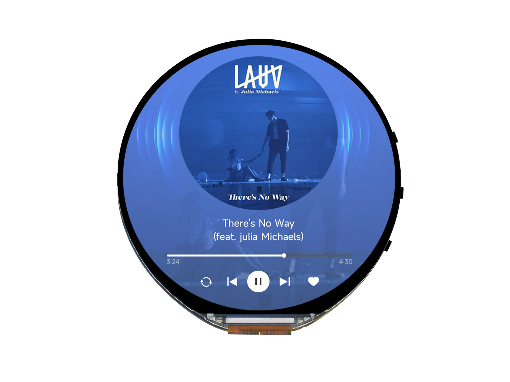

  <h1>ESP32-S3-LCD-1.85</h1>
  
<strong>ESP32-S3 development board with a 1.85-inch 360 × 360 non-touch LCD</strong>

  
<strong>English</strong> | <a href="README_ZH.md">简体中文</a>

  

    
    
  

  

    <a href="https://www.waveshare.net/shop/ESP32-S3-LCD-1.85.htm">🛒 Product</a> &middot;
    <a href="https://github.com/waveshareteam/ESP32-S3-LCD-1.85/releases">📦 Firmware</a> &middot;
    <a href="examples/esp-idf/">🧩 ESP-IDF</a> &middot;
    <a href="https://docs.waveshare.com/ESP32-S3-LCD-1.85">📖 Documentation</a>
  

  

---

## ✨ Overview

ESP32-S3-LCD-1.85 combines a round LCD with Wi-Fi, Bluetooth LE, audio and onboard sensors. The examples demonstrate the board controls, LVGL display, microSD playback and voice commands.

| Feature | Device / interface |
| --- | --- |
| MCU | ESP32-S3R8 |
| Memory | 16 MB Flash, 8 MB octal PSRAM |
| Display | 1.85-inch 360 × 360 LCD, ST77916 over quad SPI |
| Motion and RTC | QMI8658 and PCF85063 |
| Audio | Onboard microphone and PCM5101 audio output |
| Storage | microSD card slot |

## 📦 Quick Start

1. Connect the board to your computer with a USB data cable.
2. Follow the [ESP-IDF example](examples/esp-idf/ESP32-S3-LCD-1.85-Test/) to build and flash it.
3. Use the BOOT and power buttons to navigate the LCD interface.

If a ready-to-flash package is available in [Releases](https://github.com/waveshareteam/ESP32-S3-LCD-1.85/releases), follow the included flashing instructions.

## 🧪 Examples

### ESP-IDF

| Example | Main feature |
| --- | --- |
| [ESP32-S3-LCD-1.85-Test](examples/esp-idf/ESP32-S3-LCD-1.85-Test/) | Board diagnostics, LVGL, MP3 playback and voice commands |

## 🛠️ Development Environment

| Framework | Version | Examples |
| --- | --- | ---: |
| ESP-IDF | `v5.3.2` | 1 |

## 📚 Resources

- [Schematics](hardware/schematic/)
- [Mechanical drawing and downloads](https://docs.waveshare.com/ESP32-S3-LCD-1.85/Resources-And-Documents)
- [Product page](https://www.waveshare.net/shop/ESP32-S3-LCD-1.85.htm)
- [Wiki](https://docs.waveshare.com/ESP32-S3-LCD-1.85)

## 🤝 Support

- Example or repository problem: [open an issue](https://github.com/waveshareteam/ESP32-S3-LCD-1.85/issues/new/choose).
- Product usage, hardware or order questions: [Waveshare support](https://docs.waveshare.com/ESP32-S3-LCD-1.85/Technical-Support).

## 📄 License

Bundled libraries and components retain the license terms included in their respective directories.
