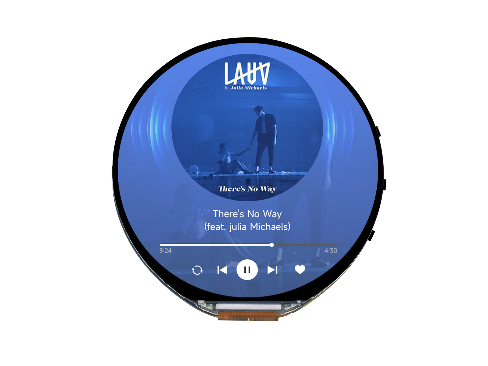

  <h1>ESP32-S3-LCD-1.85</h1>
  
<strong>配备 1.85 英寸 360 × 360 非触摸 LCD 的 ESP32-S3 开发板</strong>

  
<a href="README.md">English</a> | <strong>简体中文</strong>

  

    
    
  

  

    <a href="https://www.waveshare.net/shop/ESP32-S3-LCD-1.85.htm">🛒 产品</a> &middot;
    <a href="firmware/">📦 固件</a> &middot;
    <a href="examples/esp-idf/">🧩 ESP-IDF</a> &middot;
    <a href="https://docs.waveshare.net/ESP32-S3-LCD-1.85/">📖 文档</a>
  

  

---

## ✨ 概述

ESP32-S3-LCD-1.85 集成圆形 LCD、Wi-Fi、低功耗蓝牙、音频和板载传感器。示例演示按键操作、LVGL 界面、microSD 音乐播放和语音指令。

| 功能 | 器件或接口 |
| --- | --- |
| MCU | ESP32-S3R8 |
| 存储器 | 16 MB Flash，8 MB 八线 PSRAM |
| 显示 | 1.85 英寸 360 × 360 LCD，ST77916，四线 SPI |
| 运动传感器与 RTC | QMI8658、PCF85063 |
| 音频 | 板载麦克风、PCM5101 音频输出 |
| 存储卡 | microSD 卡槽 |

## 📦 快速开始

下载板载功能测试固件及查看烧录步骤，请前往 [`firmware/`](firmware/)。

1. 使用 USB 数据线将开发板连接到电脑。
2. 按 [ESP-IDF 示例](examples/esp-idf/ESP32-S3-LCD-1.85-Test/README_ZH.md) 的说明编译、烧录。
3. 使用 BOOT 和电源按键操作 LCD 界面。

如果 [Releases](https://github.com/waveshareteam/ESP32-S3-LCD-1.85/releases) 提供可烧录固件包，请按包内说明操作。

## 🧪 示例

### ESP-IDF

| 示例 | 主要功能 |
| --- | --- |
| [ESP32-S3-LCD-1.85-Test](examples/esp-idf/ESP32-S3-LCD-1.85-Test/README_ZH.md) | 板载外设检测、LVGL、MP3 播放和语音指令 |

## 🛠️ 开发环境

| 开发框架 | 版本 | 示例数 |
| --- | --- | ---: |
| ESP-IDF | `v5.3.2` | 1 |

## 📚 资料

- [原理图](hardware/schematic/)
- [尺寸图及下载资料](https://docs.waveshare.net/ESP32-S3-LCD-1.85/Resources-And-Documents/)
- [产品页](https://www.waveshare.net/shop/ESP32-S3-LCD-1.85.htm)
- [Wiki](https://docs.waveshare.net/ESP32-S3-LCD-1.85/)

## 🤝 支持

- 产品使用、硬件或订单问题：[微雪技术支持](https://docs.waveshare.net/ESP32-S3-LCD-1.85/Technical-Support/)。

## 📄 许可证

随附库和组件的许可证以各自目录中的文件为准。
